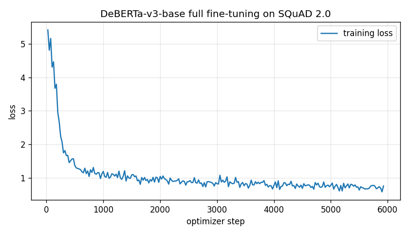

# Project Report — Extractive QA as a Service

## 0. Team

| Field | Value |
|---|---|
| Team id | `Pimientero` |
| Members | Diego Roberto Carpio Flamenco; Julio Roberto Guardado Quijano; Alfredo Enmanuel Cortez Martínez; Iván Daniel Salguero Esperanza |
| Repository URL | https://github.com/DiegoCarpio1210/Servicio-de-NLP-servido-por-medio-de-APIs |
| `submission` commit hash | The commit tagged `submission` (this report). Model code: `398a097`, CPU threads: `c0b269a`. `git rev-parse submission` prints the full hash. |
| Public service URL used at the dry run | https://tabs-regulated-basics-advised.trycloudflare.com (temporary Cloudflare Quick Tunnel; dry run made with our previous LoRA model, see Section 7) |
| AI tools used (which, and for what) | OpenAI ChatGPT/Codex and Anthropic Claude as coding assistants: code review, training-script drafting, debugging, test writing and documentation. No AI service is called at inference; every answer comes from our local model. |

## 1. Model choice and justification

- **Base checkpoint:** `microsoft/deberta-v3-base`, revision `8ccc9b6f`. Pre-trained encoder only; the QA head starts untrained (initial loss ≈5.5).
- **Alternatives considered:** DistilBERT (66M parameters) is ~3× cheaper on CPU but clearly weaker on SQuAD 2.0, and it is the instructor's reference, so it leaves no margin. BERT-base and RoBERTa-base cost the same as DeBERTa with weaker published SQuAD 2.0 results. Our own LoRA rank-4 DeBERTa reached only 65.0% weighted EM (Section 7).
- **Trade-off:** 183.8M parameters (~735 MB) make it the slowest option on CPU, yet it answers in 0.42–1.27 s per request with 4 threads, well inside the 5 s timeout; we spend that latency budget on accuracy.

## 2. Training

| Item | Value |
|---|---|
| Training data (full SQuAD 2.0 train or subset; how many examples) | Random subset of 94,000 SQuAD 2.0 training questions (seed 20261101), tokenized into 94,857 windows |
| Validation data (what you validated on, how many examples) | SQuAD 2.0 dev split by article: 1,500 questions from half the articles calibrate the threshold; 1,500 from the other half (727 answerable / 773 unanswerable) are reported |
| Epochs | 1 (5,929 optimizer steps) |
| Learning rate and schedule (warmup?) | AdamW, 3e-5, linear decay, 10% warmup, weight decay 0.01 |
| Batch size | 4 × gradient accumulation 4 = 16; dynamic padding with length grouping |
| `max_seq_length` / `doc_stride` | 384 / 128, identical in training and serving |
| Hardware and training time | NVIDIA RTX 4050 Laptop GPU (6 GB), bf16 mixed precision; 2,336 s (38.9 min) |

All encoder layers and the QA head are trained; freezing the 98M word-embedding parameters saves ~1.2 GB of optimizer memory. Script: `experiments/train_fast.py`.

- **Loss curve:** [`loss.png`](logs/deberta_full_fast/loss.png), steps in [`training_history.json`](logs/deberta_full_fast/training_history.json); previous LoRA model: [`learning_curves.png`](logs/deberta_base_training/train/learning_curves.png).


- **Validation results** (same 1,500 held-out questions, [`results.json`](logs/deberta_full_fast/results.json)):

| Model | Answerable EM / F1 | Unanswerable EM | Weighted 75/25 EM / F1 |
|---|---|---|---|
| **Submitted: full fine-tuning** | **83.91 / 88.96** | 82.02 | **83.43 / 87.22** |
| Previous: LoRA rank 4 | 59.28 / 67.41 | 82.15 | 65.00 / 71.10 |

## 3. No-answer threshold

- **Decision rule:** null score = `start_logit[CLS] + end_logit[CLS]`, minimum over windows; span score = best `start_logit[i] + end_logit[j]` over context tokens (`i ≤ j`, ≤30 tokens, one window). The service returns `null` when `null_score − best_span_score > τ`.
- **Choice of τ:** exact sweep over the 1,500 calibration questions, maximizing mean EM/F1 reweighted to the hidden set's 75/25 mix. Reported questions come from other articles. Final **τ = 0.8262**.
- **Too low / too high:** a lower τ returns more `null`s and loses answerable items; a higher τ invents spans for unanswerable questions, as in sample-04. `score` is a sigmoid of `|margin − τ|`, not a probability.

## 4. Serving architecture

- **Framework and server:** FastAPI + Uvicorn, 1 worker (`qa/api.py`).
- **Model loading:** once at startup, in a background task. `configs/active_model.json` pins `models/deberta-full-fast`; the loader verifies the SHA-256 of weights and tokenizer, that the calibration matches the weights, and runs a warm-up prediction. Until then `/health` returns `503 loading`.
- **Request flow:** strict Pydantic validation (`422 bad_request` on failure) → context split into 384-token windows, stride 128 → CPU inference in batches of 8 windows, 4 threads, under a lock → span vs. null decision (Section 3) → whitespace trimmed and `context[start:start+len(answer)] == answer` asserted → JSON.
- **Access control:** a middleware runs before routing on `/info` and `/predict`, comparing the `Authorization` header with `"Bearer " + QA_API_TOKEN` via `hmac.compare_digest` (exact, case-sensitive); otherwise `401` with `WWW-Authenticate: Bearer`. The token comes only from the environment.
- **Tunnel:** Cloudflare Quick Tunnel, `cloudflared tunnel --url http://127.0.0.1:8000`; ngrok is the tested backup.
- **How to run** (Windows, Python 3.12):

```powershell
py -3.12 -m venv .venv
.\.venv\Scripts\python.exe -m pip install torch==2.7.1 --index-url https://download.pytorch.org/whl/cpu
.\.venv\Scripts\python.exe -m pip install -r requirements.txt
# Weights: extract the release ZIP into models\deberta-full-fast\, or rebuild them
# (~40 min on an RTX 4050, CUDA build of torch):
#   python -m experiments.train_fast --train-examples 94000
$env:TEAM_ID = "Pimientero"
$env:QA_API_TOKEN = "<token>"
.\.venv\Scripts\python.exe -m uvicorn qa.api:app --host 127.0.0.1 --port 8000 --workers 1
```

## 5. Results on the public sample set

Local CPU run via HTTP ([`public_cpu.json`](logs/deberta_full_fast/public_cpu.json)):

| Item | Expected | Your answer | `start` | Correct? |
|---|---|---|---|---|
| sample-01 | `16` / `16 attention heads` | `16` | 383 | Yes |
| sample-02 | `3.5 days` | `3.5 days` | 437 | Yes |
| sample-03 | `null` | `null` | `null` | Yes |
| sample-04 | `null` | `3 times` | 310 | **No** |
| sample-05 | `50,257` / `50,257 tokens` | `50,257` | 3157 | Yes |

**sample-04** asks about *BERT-base*, but the context gives "3 times" only for *GPT-3 175B*. The sentence matches the question's wording almost exactly, so the span outscores null; the model does not check that the entity matches. **sample-05** (answer in the last sentence of 3,171 characters) failed with our previous model, trained on 256-token windows but served with 384; training at 384/128 fixed it.

**Official HTTPS dry run** (Nov 1, previous LoRA model: 3/5 correct, 0.93–2.28 s round trip; same API code as now):

| Check | Expected | Evidence |
|---|---|---|
| 1. `GET /health`, no token | HTTP 200 | [Screenshot 1](docs/dry_run/DryRun_01_Health.png) |
| 2. `GET /info`, no token | HTTP 401 | [Screenshot 2](docs/dry_run/DryRun_02_Sin_Token.png) |
| 3. `GET /info`, wrong token | HTTP 401 | [Screenshot 3](docs/dry_run/DryRun_03_Token_Incorrecto.png) |
| 4. `GET /info`, valid token | HTTP 200 | [Screenshot 4](docs/dry_run/DryRun_04_Token_Correcto.png) |
| 5. `POST /predict`, valid token | HTTP 200 | [Screenshot 5](docs/dry_run/DryRun_05_Predict.png) |

<details><summary>Screenshots</summary>

**1 — /health: 200**


**2 — no token: 401**


**3 — wrong token: 401**


**4 — valid token: 200**


**5 — /predict: 200**


</details>

[All five dry-run predictions and timings](docs/dry_run/DryRun_06_Public_Samples.png).

## 6. Model size and latency (not graded)

| Item | Value |
|---|---|
| Parameters | 183,833,090 |
| Size on disk | ≈735 MB (`model.safetensors`, FP32) |
| Mean latency per `/predict` request on your laptop (CPU) | 0.64 s mean, 1.27 s max over the five public samples (4 threads; HTTP on 127.0.0.1) |
| Laptop CPU and RAM | HP Victus, Intel Core i7-12650H (10 cores, 16 threads), 16 GB RAM |

Fifty items need ~32 s, under the 150 s cap.

## 7. Problems encountered and how you fixed them

1. **Problem:** an early deployment served `deepset/deberta-v3-base-squad2`. **Cause:** chosen for accuracy, but rule V.1 forbids SQuAD-fine-tuned checkpoints. **Fix:** trained from `microsoft/deberta-v3-base`; `tests/test_security.py` now fails for any other base. **Commit:** `919189b`, test in `398a097`.
2. **Problem:** our first own model reached 59.3% answerable EM and missed sample-05. **Cause:** LoRA rank 4 on a frozen backbone (batch 1, FP32, older laptop) and 256/96 training windows vs. 384/128 at serving. **Fix:** full fine-tuning in bf16 on an RTX 4050, 384/128 everywhere: answerable EM 83.9%, sample-05 correct. **Commit:** `398a097`.
3. **Problem:** answers like `" 16"` at 382 instead of `"16"` at 383. **Cause:** SentencePiece offsets include the preceding space (`▁`). **Fix:** `qa/spans.py` trims whitespace and shifts `start`. **Commit:** `398a097`.
4. **Problem:** 2.37 s per request in the local UI. **Cause:** inference defaulted to 2 CPU threads. **Fix:** default of 4 threads (0.42–1.27 s). **Commit:** `c0b269a`.

## 8. Decoder investigation

- **Unsupported entity (sample-04).** Our head only compares span and null scores, so a sentence matching the question wins even when the entity differs. An encoder–decoder (e.g. Flan-T5-base) could generate "unanswerable" or name the entity it relies on, adding a verification step. Cost: token-by-token generation (several times our CPU latency), outputs must be mapped back to a verbatim span by string search, and hallucinations fail exact match.
- **Long contexts (sample-05).** We split texts into overlapping windows and had to align training and serving windows. A long-context decoder reads all 5,000 characters at once. Cost: quadratic attention, and 1B+ parameter models exceed the 5 s CPU budget.
- **Offsets (problem 3).** Generated text has no offsets and is ambiguous to locate when a string repeats; extraction returns `start` by construction.
- **Yes/no and non-contiguous answers.** "Is DeBERTa larger than DistilBERT?" gets a span or `null` from us; a decoder could say "yes", but that does not fit the `context[start:...]` contract.

## 9. Known limitations

- English only; contexts over 5,000 or questions over 500 characters get `422`; questions are cut to 64 tokens.
- One contiguous span of ≤30 tokens; yes/no, arithmetic and multi-span questions get the closest span or `null`.
- Entity-swap questions (sample-04) can yield confident false answers; unanswerable EM is 82%.
- Boundaries may differ from references (`422 km` vs. `about 422 km`), giving partial matches.
- Non-SQuAD texts may score lower.
- One worker answers sequentially; parallel callers queue.
- The Quick Tunnel URL changes on restart and has no uptime guarantee.
