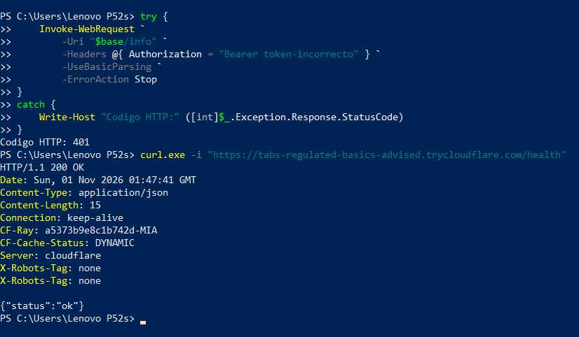
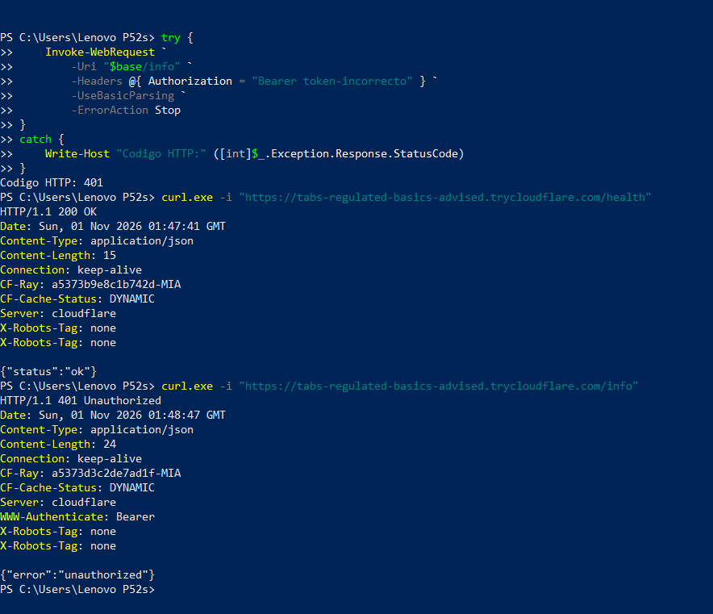
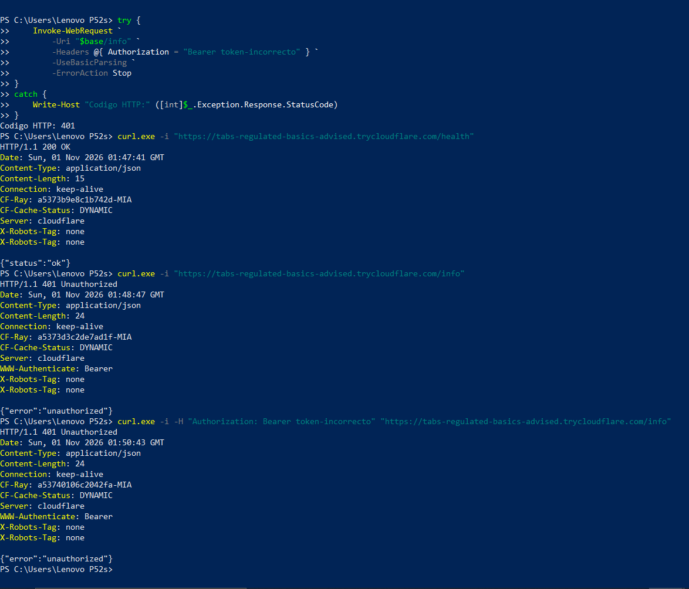
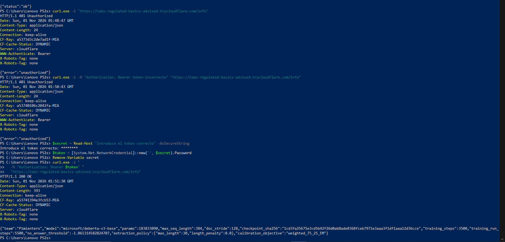
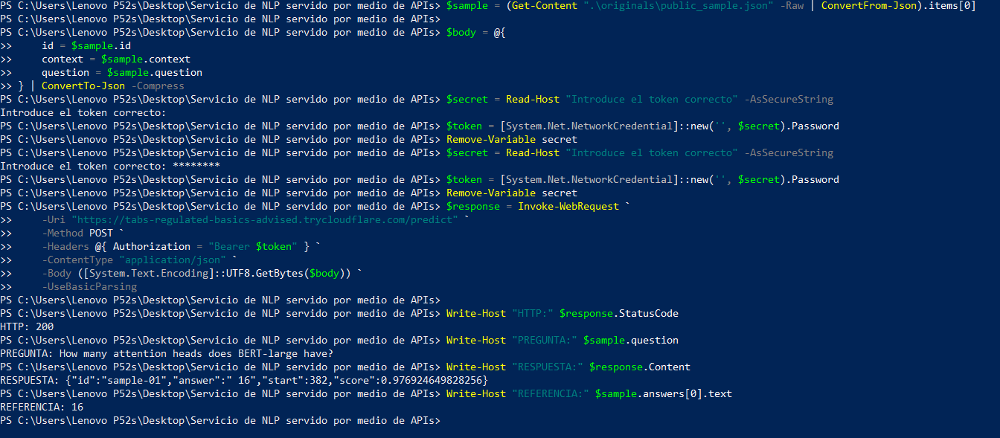

# Project Report — Extractive QA as a Service

## 0. Team

| Field | Value |
|---|---|
| Team id | `Pimientero` |
| Members | Diego Roberto Carpio Flamenco; Julio Roberto Guardado Quijano; Alfredo Enmanuel Cortez Martínez; Iván Daniel Salguero Esperanza |
| Repository URL | https://github.com/DiegoCarpio1210/Servicio-de-NLP-servido-por-medio-de-APIs |
| `submission` commit hash | The final submission commit is identified by Git tag [`submission`](https://github.com/DiegoCarpio1210/Servicio-de-NLP-servido-por-medio-de-APIs/tree/submission); use `git rev-parse submission` to obtain its SHA after tagging. |
| Public service URL used at the dry run | https://tabs-regulated-basics-advised.trycloudflare.com (temporary Quick Tunnel; available only while the laptop, API, and tunnel are running) |
| AI tools used (which, and for what) | ChatGPT/OpenAI coding assistance for implementation review, experiments, debugging, documentation, and test orchestration. All submitted QA predictions are made locally by the team's own model; no commercial inference API is called. |

## 1. Model choice and justification

Our submitted model is `microsoft/deberta-v3-base`, original base revision `8ccc9b6f36199bec6961081d44eb72fb3f7353f3`. We trained a new extractive QA head and LoRA rank-4 adapters from this **base checkpoint**, not from a checkpoint already fine-tuned on SQuAD. After training, the selected adapter and QA head were merged/exported as the standalone model used by the API. DeBERTa was preferred over earlier DistilBERT experiments because its contextual representations offered a stronger starting point; the trade-off is a larger CPU model (183,833,090 parameters, about 735 MB of raw weights) and greater inference cost. Previous specialized QA checkpoints remain historical comparisons only; they are **not** the active submission model.

## 2. Training

| Item | Value |
|---|---|
| Training data | 20,000 SQuAD 2.0 training examples; tokenized into 21,715 windows (13,586 positive, 8,129 null windows) |
| Validation data | SQuAD 2.0 validation; a 500-item check (250 answerable / 250 unanswerable), followed by a separate 1,000-item check (750 answerable / 250 unanswerable) |
| Epochs | Approximately 2 effective passes over the 21,715 training windows, estimated from 5,500 optimizer updates × effective batch size 8; the trainer was step-based with early stopping, not configured by a fixed epoch count |
| Fine-tuning | LoRA rank 4, alpha 8, dropout 0.05, plus a newly initialized QA head; frozen pretrained backbone |
| Learning rate / warmup | LoRA `0.0002`, QA head `0.0005`, warmup 500 updates; training configuration records these values |
| Batch size / precision | Microbatch 1, gradient accumulation 8 (effective batch 8); FP32 |
| Training `max_seq_length` / `doc_stride` | 256 / 96; inference uses 384 / 128 |
| Training duration | 5,500 optimizer steps; recorded training time 12,726.52 seconds (~3 h 32 min); early stopped from configured 10,000-step ceiling |
| Selected checkpoint | Step 3,500 (best recorded validation loss ~0.8934) |
| Hardware | Lenovo P52s laptop; local training and CPU serving. GPU/CPU device details for the training process should be cross-checked against its execution log rather than assumed. |

The training evidence includes [the loss curves](logs/deberta_base_training/train/learning_curves.png), [history](logs/deberta_base_training/train/training_history.json), [configuration](logs/deberta_base_training/train/config.json), [validation metrics](logs/deberta_base_training/train/validation_metrics.json), and [summary](logs/deberta_base_training/train/final_summary.json). On the 500-item check, the own model reached **68.40% EM / 74.65% F1** (answerable EM 53.60%, unanswerable EM 83.20%). On the 1,000-item check (different answerability mix), it reached **66.30% EM / 72.87% F1** (answerable EM 60.93%, unanswerable EM 82.40%). These sets have different compositions, so the scores are not directly comparable without qualification.

## 3. No-answer threshold

The extractive head scores candidate start/end spans and a no-answer alternative derived from the CLS position across sliding windows. A frozen threshold of **-1.061314582824707** was selected using validation-time weighted-75/25 Exact Match calibration. Predictions abstain (`answer: null`, `start: null`) when the no-answer evidence meets the calibrated decision rule; otherwise, the top eligible context span is returned, subject to a 30-token extraction limit. A threshold that is too permissive increases unsupported spans (false positives); one that is too conservative increases incorrect null outputs (false negatives). The public dry run shows both failure modes. The `score` field is a bounded model-derived score, not a calibrated probability of factual correctness.

## 4. Serving architecture

The service uses FastAPI and Uvicorn (one worker), with local CPU inference and an API listening on `127.0.0.1:8002` for the dry run (the standard local port is 8000). Startup loads the exported DeBERTa model and tokenizer and verifies configured file hashes; `/health` returns `ok` after the model becomes available. A `POST /predict` authenticates its Bearer token, validates `id`, `context`, and `question`, tokenizes the question and context, runs overlapping windows for long contexts, compares span and null scores, and returns `{id, answer, start, score}`. The `start` index refers to the original context; leading whitespace in predicted spans remains a known issue. `/info` reports the base checkpoint and model metadata. The secret is supplied only through the `QA_API_TOKEN` environment variable and is never hardcoded.

The public HTTPS endpoint was provided by Cloudflare Quick Tunnel using `tools\cloudflared.exe tunnel --url http://127.0.0.1:8002`. An independently connected mobile network returned `/health: ok`. Example Windows setup, from the repository root after creating `.venv` and installing `requirements.txt`:

```powershell
# Download the release asset Pimientero-AI-DeBERTa-3500.zip and extract it
# so that models\deberta-base-student\ contains model.safetensors and tokenizer files.
$env:TEAM_ID = "Pimientero"
$env:MODEL_DIR = (Resolve-Path 'models\deberta-base-student').Path
$secret = Read-Host 'API token' -AsSecureString
$env:QA_API_TOKEN = [System.Net.NetworkCredential]::new('', $secret).Password
Remove-Variable secret
.\.venv\Scripts\python.exe -m uvicorn qa.api:app --host 127.0.0.1 --port 8002 --workers 1
# In another PowerShell window:
.\tools\cloudflared.exe tunnel --url http://127.0.0.1:8002
```

The release asset is available under GitHub tag `v1.0.0-student`. The tunnel URL is ephemeral and must be re-shared for the live presentation; changing the instructor-provided token requires restarting the API process with the new environment value.

## 5. Results on the public sample set

All five official `originals/public_sample.json` requests were sent via the **public HTTPS tunnel** with valid Bearer authentication, and all returned HTTP 200. Screenshots of the five contract checks are embedded below and stored in [`docs/dry_run/`](docs/dry_run/).

| Item | Expected | Our answer | `start` | Correct? | HTTPS time |
|---|---|---|---:|---|---:|
| sample-01 | `16` or `16 attention heads` | ` 16` | 382 | Yes after whitespace normalization; reference starts at 383 | 1.31 s |
| sample-02 | `3.5 days` | ` 3.5 days` | 436 | Yes after whitespace normalization; reference starts at 437 | 0.94 s |
| sample-03 | `null` | `null` | `null` | Yes | 0.99 s |
| sample-04 | `null` | ` 3 times` | 309 | **No**: unsupported span from an unrelated comparison | 0.93 s |
| sample-05 | `50,257` or `50,257 tokens` | `null` | `null` | **No**: missed the answer in a long context | 2.28 s |

Result: **3/5 correct (60%)**, accepting whitespace-normalized equivalent spans; no HTTP failures. Sample-04 is a false positive; sample-05 is a false negative on the explicitly long-context case. These outcomes have **not** been hidden or post-hoc adjusted.

**Official dry-run evidence (all calls used the public HTTPS URL):**

| Check | Expected | Evidence |
|---|---|---|
| 1. `GET /health`, no token | HTTP 200 | [Screenshot 1](docs/dry_run/DryRun_01_Health.png) |
| 2. `GET /info`, no token | HTTP 401 | [Screenshot 2](docs/dry_run/DryRun_02_Sin_Token.png) |
| 3. `GET /info`, wrong token | HTTP 401 | [Screenshot 3](docs/dry_run/DryRun_03_Token_Incorrecto.png) |
| 4. `GET /info`, valid token | HTTP 200 | [Screenshot 4](docs/dry_run/DryRun_04_Token_Correcto.png) |
| 5. `POST /predict`, valid token | HTTP 200 | [Screenshot 5](docs/dry_run/DryRun_05_Predict.png) |

<details><summary>View screenshots of all five official contract checks</summary>

**1 — Health without token: HTTP 200**



**2 — Info without token: HTTP 401**



**3 — Info with incorrect token: HTTP 401**



**4 — Info with valid token: HTTP 200**



**5 — Predict with valid token: HTTP 200**



</details>

[Additional evidence: all five public-sample predictions and observed timings](docs/dry_run/DryRun_06_Public_Samples.png).

## 6. Model size and latency (not graded)

| Item | Value |
|---|---|
| Parameters | 183,833,090 |
| Raw `model.safetensors` | 735,356,752 bytes |
| Release ZIP | 450,351,748 bytes |
| Laptop | Lenovo P52s, approximately 32 GiB RAM; CPU-only serving |
| Mean public HTTPS latency, five official items | 1.29 s per request (6.45 s total) |
| Maximum observed public HTTPS latency, five items | 2.28 s |

All five observed requests were under the instructor's 5-second per-request limit. These measurements do not guarantee the future hidden set's latency or the 150-second global cap.

## 7. Problems encountered and how you fixed them

1. **Checkpoint compliance and reproducibility.** Earlier experimental deployments used a third-party SQuAD-specialized checkpoint, which is not eligible under the project brief. **Fix:** trained LoRA adapters and a new QA head from the original `microsoft/deberta-v3-base` checkpoint, froze calibration, and exported verified weights. **Evidence/commit:** training and evaluation additions `ed7ed45`, deployment activation `919189b`.
2. **Stale active-model metadata and dashboard metrics.** The service/UI initially reported a prior model's evaluation despite the new model being selected. **Fix:** pinned `configs/active_model.json` to the own model and linked the UI to the matching 1,000-item evaluation report. **Commit:** `919189b`.
3. **Answer abstention and long contexts.** The public dry run returned an unsupported span for `sample-04` and `null` for answerable `sample-05`. **Current mitigation:** sliding-window inference and calibrated abstention were retained, and failure cases explicitly documented; **not resolved** in the submitted model.

## 8. Decoder investigation

For `sample-04`, a decoder could produce a natural-language explanation that the question is unsupported, but generation can hallucinate, is slower on CPU, and would need to be mapped back to the required `null` API response. For `sample-05`, an encoder–decoder with retrieval/chunk selection might integrate long contexts and locate evidence more flexibly; this increases computational cost and changes the exact character-offset mapping. Neither alternative was implemented because the assignment requires an extractive encoder and a 5-second request deadline. For noncontiguous or yes/no answers, generative models can express an answer more naturally but cannot satisfy the strict verbatim-span contract without additional verification.

## 9. Known limitations

The model sometimes confuses related but unsupported details with an answer, or abstains incorrectly on long contexts. Its extraction can include leading spaces (with corresponding offset differences). The 1,000-item SQuAD validation result is not a guarantee of performance on the instructor's 50 hidden, out-of-distribution questions. CPU-only inference and Cloudflare routing may vary with laptop load and network quality; the public Quick Tunnel has no uptime guarantee and stops when the laptop/API/tunnel stops. The submission's weights live in a GitHub Release rather than in Git, so clean installations must download and extract the release package. The service handles English extractive QA, not open-ended reasoning or answer synthesis.
