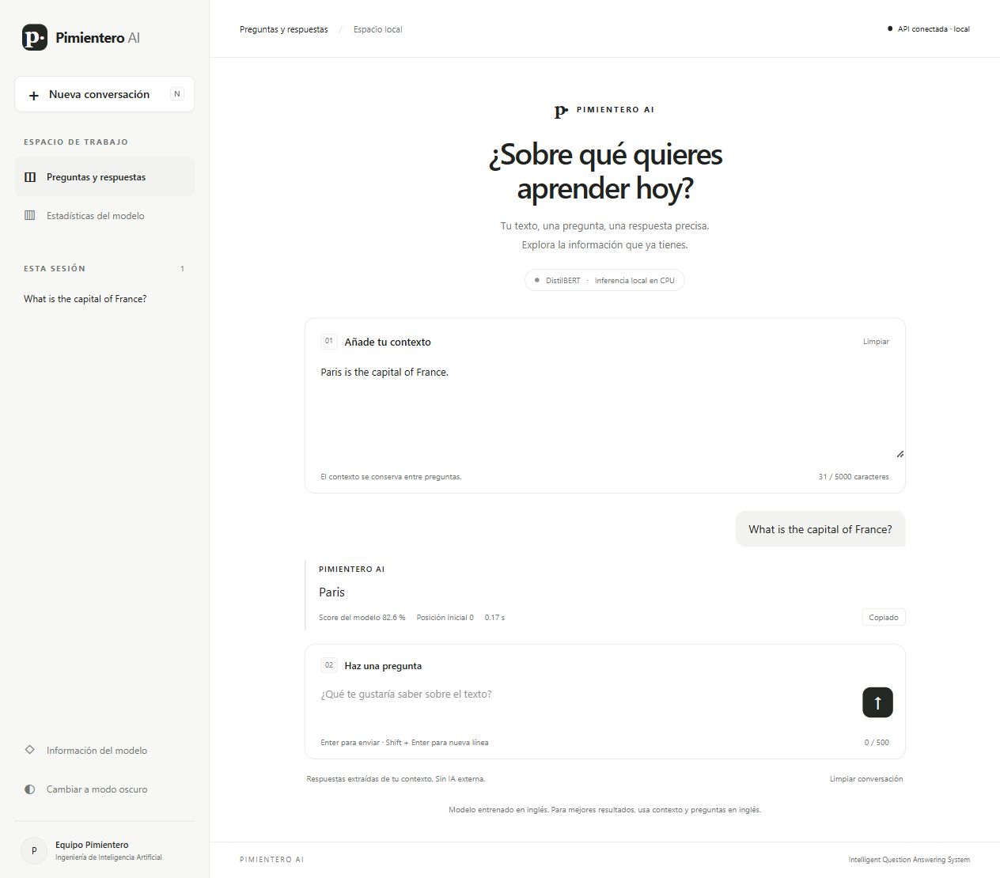
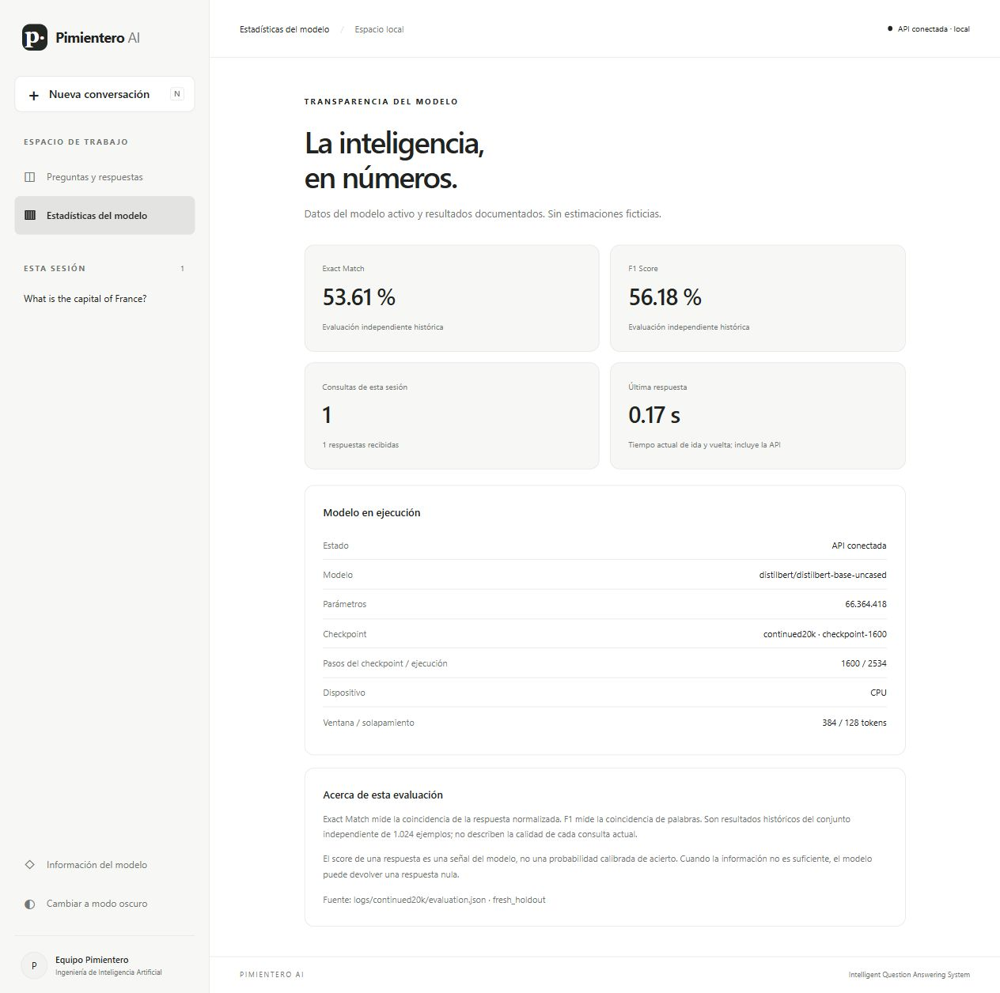
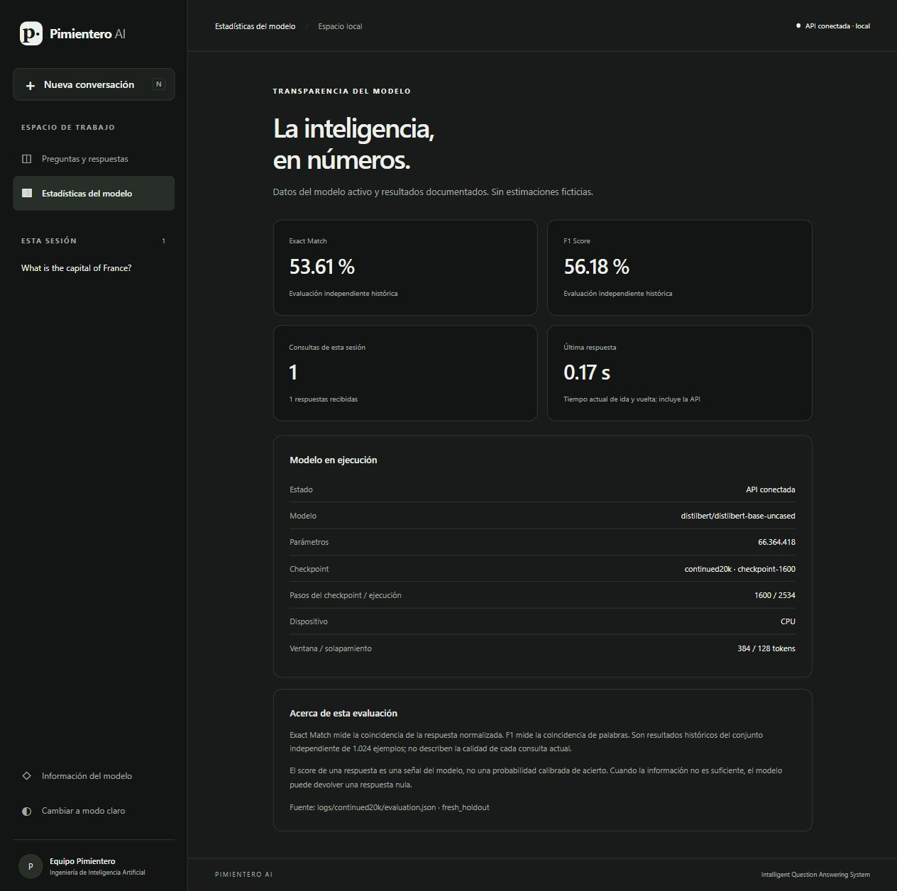
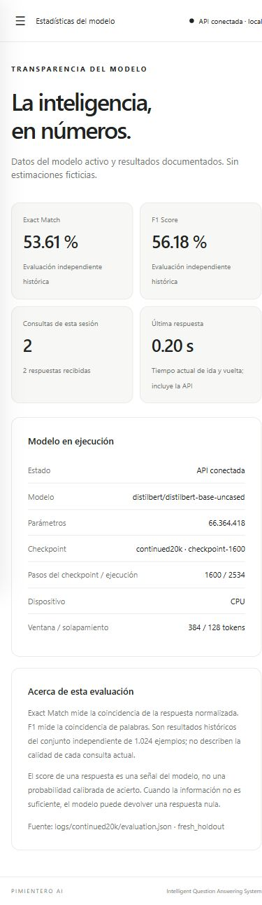

# PIMIENTERO AI — aplicación local

Intelligent Question Answering System. Interfaz opcional para explorar textos mediante el modelo real
DistilBERT continued20k, checkpoint-1600. No reemplaza la API académica ni mejora por sí misma su precisión.

## Iniciar en Windows

1. Dentro de la carpeta del proyecto, haz doble clic en **INICIAR_PIMIENTERO.bat**.
2. Espera a que termine la carga del modelo en CPU. El navegador predeterminado se abre automáticamente
   en **http://127.0.0.1:8765**. La primera carga puede tardar unos minutos.
3. Introduce un contexto y una pregunta, preferiblemente en inglés. Pulsa la flecha o Enter.
   Shift+Enter introduce una línea nueva. No hace falta introducir tokens ni iniciar túneles.
4. Para detenerla, ejecuta **DETENER_PIMIENTERO.bat**, o pulsa Ctrl+C en la ventana de inicio.
   Espera el mensaje de cierre antes de cerrar esa ventana. Cerrar solo la pestaña no detiene los servicios.

La ejecución normal muestra una consola con el estado de carga. Una segunda ejecución no inicia otro modelo.
Si otro programa ocupa 8000 o 8765, el lanzador se niega a reutilizarlo y explica el conflicto; no mata procesos ajenos.
Si se cierra Windows o se termina abruptamente el lanzador, revisa los procesos/puertos antes de volver a iniciar.

## Dependencias y archivos locales

Se reutilizan Python, FastAPI, Uvicorn, HTTPX, Torch y Transformers ya fijados en `requirements.txt`.
No se requiere Node, npm, compilación del frontend, CDN, conexión a un proveedor de IA ni fuente remota.
Para una instalación nueva, desde PowerShell en la carpeta del repositorio:

```powershell
py -m venv .venv
.\.venv\Scripts\python.exe -m pip install -r requirements.txt
```

Los pesos no están en GitHub. Hay que restaurar el directorio `models/continued20k/` de la copia autorizada
del equipo, incluidos pesos, configuración, tokenizer, metadatos y `calibration.json`.
El lanzador verifica los hashes del modelo y de la calibración seleccionados; no los descarga ni los modifica.
Ni la instalación de dependencias ni la interfaz ejecutan entrenamiento o descargan SQuAD.

## Uso y privacidad de la sesión

- El contexto se mantiene entre consultas. Puedes editarlo o limpiarlo; nunca se trunca silenciosamente.
- Los límites son 5.000 caracteres de contexto y 500 de pregunta, contando puntos de código Unicode como Python.
- El historial conserva preguntas, respuestas y contextos **en memoria de la pestaña**. Elegir una pregunta
  recupera su contexto y resultado anterior; enviarla otra vez ejecuta una nueva inferencia.
- Nueva conversación limpia la vista y el contexto. Limpiar conversación limpia la vista conservando el contexto.
  Ambas conservan el historial de la sesión. Recargar o cerrar la pestaña borra ese historial.
- El modo claro es predeterminado; el botón de apariencia activa el modo oscuro durante la sesión.
- Una respuesta `null` se presenta como ausencia de respuesta en el contexto, sin sustituirla por una invención.
- El score es una señal del modelo, **no una probabilidad calibrada de acierto**. El offset es el índice original
  de caracteres, empezando por cero. El botón Copiar copia solo el texto de una respuesta no nula.
- El dashboard distingue resultados históricos de evaluación de conteos y tiempos de la sesión actual.
  EM 53,61 % y F1 56,18 % proceden de `fresh_holdout` en `logs/continued20k/evaluation.json` (1.024 ejemplos).
- No hay persistencia de conversaciones en disco, analítica, cookies de seguimiento ni servicios de IA externos.
  Los logs locales de Uvicorn registran rutas y códigos HTTP, no cuerpos ni tokens.

## Arquitectura y seguridad

```text
Navegador → 127.0.0.1:8765 (qa.ui, frontend)
                      ↓ HTTPX + Bearer solo en memoria del servidor
            127.0.0.1:8000 (qa.api original) → DistilBERT CPU
```

`frontend/` contiene HTML semántico, CSS responsive y JavaScript sin dependencias.
`qa/ui.py` sirve recursos estáticos y un proxy restringido a las tres rutas de la API. No acepta una URL
de destino proporcionada por el navegador. No carga un segundo modelo.
`scripts/local_app.py` genera un token aleatorio por ejecución y lo entrega por entorno solo a sus dos hijos.
El token no se envía al navegador ni se escribe en archivos. Los procesos se enlazan únicamente a loopback.
El proxy verifica Host, Origin y un encabezado de escritura; no habilita CORS. CSP impide scripts externos y
embebido en frames. Estas medidas no pretenden aislar al propietario del sistema ni a programas maliciosos
que ya se ejecuten en su cuenta local.

**No publiques el puerto 8765 mediante Cloudflare/ngrok.** Esta interfaz es un acceso local de confianza.
La evaluación del profesor continúa usando la API original en 8000 y su token oficial, configurado por separado.
No ejecutes simultáneamente el lanzador local y otro servidor académico en el mismo puerto.
`qa/api.py`, los pesos, la calibración y las métricas académicas no se modificaron para integrar la interfaz.

## Verificación ejecutada

- Suite completa: **58 pruebas superadas** (`logs/ui_pytest.txt`), incluyendo las 51 existentes y 7 casos nuevos
  del gateway (parametrizaciones incluidas). Seguridad de origen/Host, token solo servidor, null, límites y errores.
- Modelo real a través del gateway: respuesta, null, Unicode (offset 2), contexto largo de 3.631 caracteres
  (respuesta en offset 3.600), rechazo de 5.001 caracteres y API académica protegida.
  Resultados exactos: `logs/ui_http_verification.json`. Son smoke tests, no una nueva evaluación de precisión.
- Revisión de navegador en Windows: consulta real, ausencia de respuesta, contexto/pregunta vacíos, exceso de
  longitud, copia, historial recuperable, modo oscuro, dashboard, menú responsive a 390×844 y error al cerrar servicios.
- Inicio, cierre y prevención de duplicados del lanzador comprobados en esta laptop. La compatibilidad con una
  segunda computadora o versiones antiguas de navegador no se ha probado.

Para repetir las pruebas con la aplicación iniciada:

```powershell
.\.venv\Scripts\python.exe -m pytest -q
.\.venv\Scripts\python.exe -m scripts.verify_ui
```

## Capturas reales

Actualización del dashboard: muestra los resultados verificados de la candidata
quality40k (EM 61,82 %, F1 65,53 %, EM respondibles 48,05 %, imposibles 75,59 %,
ponderado 54,93 %), leídos de `logs/quality20261029/final_comparison.json`.
El panel «Modelo en ejecución» continúa identificando continued20k. Mostrar las
métricas de la candidata no la activa para responder consultas. Se conserva el diseño.

Estas capturas documentan las pruebas visuales originales. La etiqueta actual del
score aclara «Score (no probabilidad)»; el porcentaje visible en capturas antiguas
no representa una probabilidad de que la respuesta sea correcta.






## Si algo falla

La ventana de inicio explica dependencias ausentes, pesos incorrectos o puertos ocupados. Los logs están en
`tmp/local-app/8000.log` y `8765.log`, ignorados por Git. Si la interfaz indica desconexión, inicia el `.bat`,
espera a que esté lista y vuelve a intentar. Un error de inferencia conserva la pregunta para reintentar.
Ante pesos/calibración distintos, restaura los artefactos seleccionados: no cambies los hashes para eludir la verificación.
